<div align="center">

# ⚡ QuickBite

### Production-Grade Full-Stack Food Delivery Platform & Real-Time Logistics Engine

[](https://openjdk.org/projects/jdk/21/)
[](https://spring.io/projects/spring-boot)
[](https://nextjs.org/)
[](https://react.dev/)
[](https://www.typescriptlang.org/)
[](https://tailwindcss.com/)
[](https://www.postgresql.org/)
[](https://flywaydb.org/)
[](https://razorpay.com/)
[](https://www.docker.com/)

<p align="center">
  A high-throughput food delivery platform engineered with Spring Boot 3, Next.js 16, and Server-Sent Events. Inspired by industrial platforms like Swiggy, Zomato, and DoorDash, QuickBite enforces a strict finite-state order machine, dual-mode checkout (Razorpay + Cash on Delivery), concurrency control, and zero-trust Role-Based Access Control (RBAC).
</p>

[System Architecture](docs/architecture.md) • [REST API Reference](docs/api-reference.md) • [Database Architecture](docs/database-design.md) • [Local Setup Guide](docs/local-development.md) • [Engineering Roadmap](docs/roadmap.md)

</div>

---

## 📌 Repository Status

> **Active Portfolio & Engineering Milestone**
> The core ordering lifecycle, kitchen dispatching, driver assignment, payment verification, and real-time SSE telemetry are **100% implemented, integrated, and verified across all four user roles**. Current iterations are focused on production cloud deployment and observability.

---

## 📑 Table of Contents

1. [Executive Summary & Technical Highlights](#-executive-summary--technical-highlights)
2. [User Personas & Supported Roles](#-user-personas--supported-roles)
3. [Visual Showcase & Application Screenshots](#-visual-showcase--application-screenshots)
4. [Verified Feature Matrix](#-verified-feature-matrix)
5. [Technology Stack](#-technology-stack)
6. [System Architecture](#-system-architecture)
7. [Core Business Workflows](#-core-business-workflows)
8. [Data Model & Database Architecture](#-data-model--database-architecture)
9. [Repository Structure](#-repository-structure)
10. [Prerequisites](#-prerequisites)
11. [Local Installation & Setup](#-local-installation--setup)
12. [Environment Variables Matrix](#-environment-variables-matrix)
13. [API Surface Overview](#-api-surface-overview)
14. [Security, Auth & Rate Limiting](#-security-auth--rate-limiting)
15. [Testing & Quality Verification](#-testing--quality-verification)
16. [Payments & Financial Settlement](#-payments--financial-settlement)
17. [Troubleshooting Guide](#-troubleshooting-guide)
18. [Current Limitations & Roadmap](#-current-limitations--roadmap)
19. [Security & Responsible Disclosure](#-security--responsible-disclosure)
20. [Contributing](#-contributing)
21. [License & Repository Metadata](#-license--repository-metadata)

---

## 🚀 Executive Summary & Technical Highlights

QuickBite is built to address the operational challenges of multi-stakeholder hyperlocal food logistics: coordinating customers, restaurant kitchens, delivery partners, and platform administrators in real time with data consistency.

### Key Engineering Achievements:
- **Strict Finite State Machine:** Order transitions are mathematically verified and enforced by [`OrderLifecycleService`](file:///home/kuber/projects/quickbite-app/src/main/java/com/quickbite/order/OrderLifecycleService.java). Invalid or out-of-sequence transitions (e.g., driver picking up an unaccepted order) are strictly rejected with HTTP `400/409`.
- **Decoupled Financial & Delivery States:** Payment status (`PENDING`, `SUCCESS`, `FAILED`) is isolated from delivery status. Cash on Delivery (COD) orders remain in pending settlement until the driver or operator explicitly confirms cash handover via an authorized verification endpoint.
- **Race-Condition-Free Dispatch:** Delivery claiming utilizes optimistic locking (`@Version`) with JPA entity versioning to prevent double-assignment when multiple delivery partners accept the same delivery simultaneously.
- **Lightweight, Resilient Real-Time Telemetry:** Replaced legacy WebSockets with HTTP/2-friendly Server-Sent Events (SSE) via [`SseService`](file:///home/kuber/projects/quickbite-app/src/main/java/com/quickbite/event/SseService.java). Operates with zero external broker dependencies in single-node mode, featuring role-scoped event broadcasting, automatic client reconnection, and keepalive heartbeat pings.
- **Zero-Trust Security Perimeter:** Stateless JWT authentication with strict Role-Based Access Control (RBAC). Identifiers from request bodies are ignored in favor of the validated JWT principal to eliminate Insecure Direct Object Reference (IDOR) vulnerabilities.
- **Token-Bucket Rate Limiting:** Implemented via `Bucket4j` (`RateLimitFilter`) protecting authentication and payment endpoints (50 requests/min/IP).
- **Spatial Discovery Engine:** Native SQL implementation of the spherical Haversine formula on indexed coordinates `(latitude, longitude)`, querying 10,000+ Indian restaurants across 28 cities with sub-millisecond response times.

---

## 👥 User Personas & Supported Roles

QuickBite provides dedicated, role-tailored workflows for four platform personas:

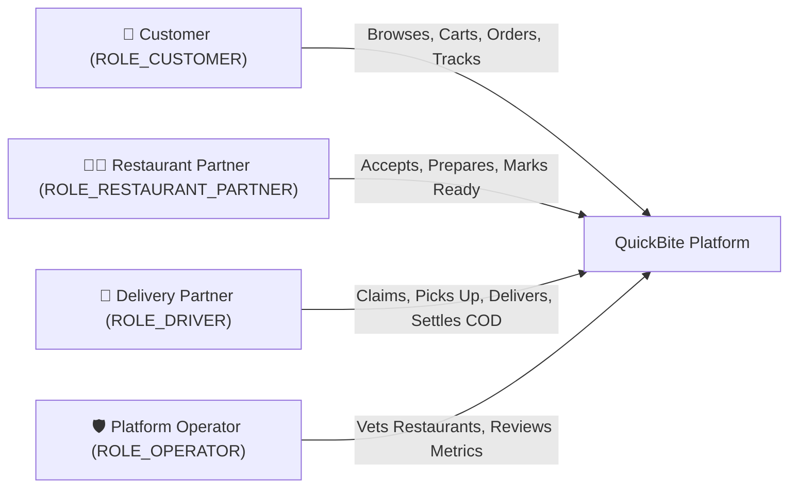

| Role | Primary Interface | Capabilities |
| :--- | :--- | :--- |
| **Customer** | `/restaurants`, `/cart`, `/checkout`, `/orders/[id]` | Discover restaurants by cuisine/city/distance, customize items, choose Online or COD payment, monitor live state changes. |
| **Restaurant Partner** | `/restaurant/dashboard` | Live kitchen display system (KDS), multi-branch switching, real-time audio/visual order notifications, status progression. |
| **Delivery Partner** | `/driver` | Dispatch pool browsing, one-click delivery claiming, turn-by-turn order details, dedicated COD cash collection settlement. |
| **Platform Operator** | `/admin/dashboard` | Platform statistics, KYC restaurant onboarding reviews, one-click application approval/rejection. |

---

## 📸 Visual Showcase & Application Screenshots

A visual walkthrough of QuickBite across all core user journeys—from restaurant discovery and dual-mode checkout to kitchen order dispatch and live delivery tracking:

### 1. Customer Discovery & Search
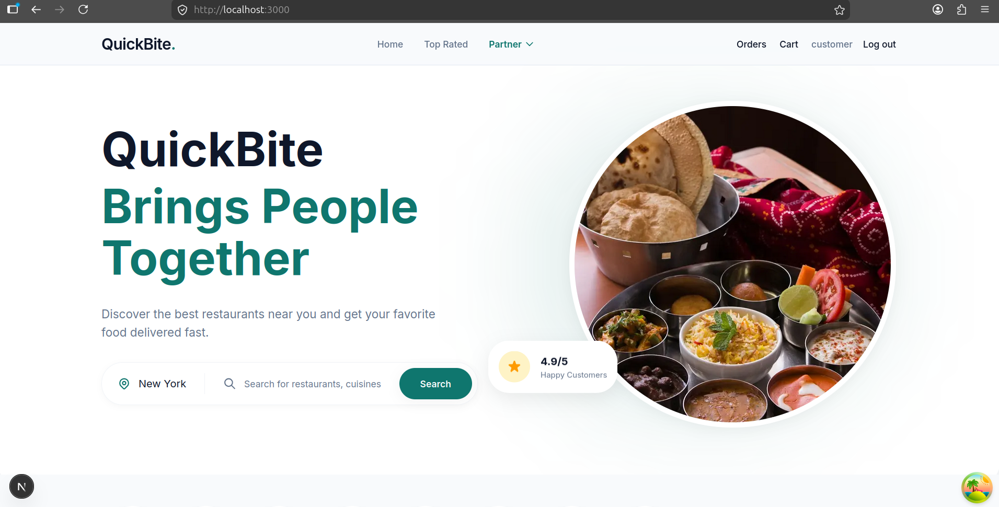

*Figure 1: **Customer Landing & Discovery Portal** (`docs/screenshots/home.png`) — City-level localization selector, cuisine search bar, customer review metrics (`4.9/5 Happy Customers`), and quick-access navigation for cart and active orders.*

---

### 2. Multi-City Restaurant Directory
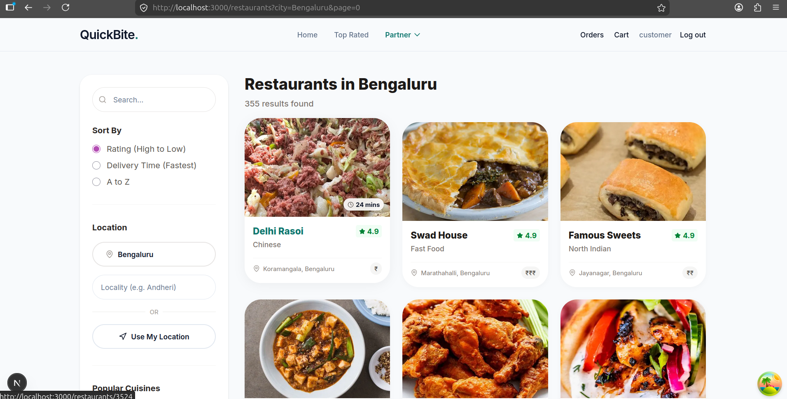

*Figure 2: **Restaurant Catalogue & Dynamic Filters** (`docs/screenshots/restaurants.png`) — Filtered browsing of approved partner kitchens in Bengaluru, displaying delivery ETAs (`24 mins`), ratings (`★ 4.9`), price indicators, locality filtering, and multiple sorting dimensions.*

---

### 3. Dual-Mode Checkout & Payment Processing
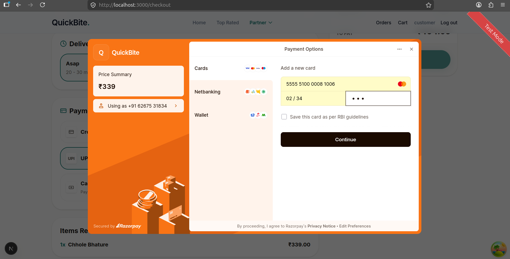

*Figure 3: **Checkout & Payment Gateway Modal** (`docs/screenshots/payment.png`) — Order summary with dual payment options (Cards, Netbanking, Wallets, and Cash on Delivery). Features the secure Razorpay payment modal with test-mode indicator and card entry fields.*

---

### 4. Restaurant Kitchen Display System (KDS)
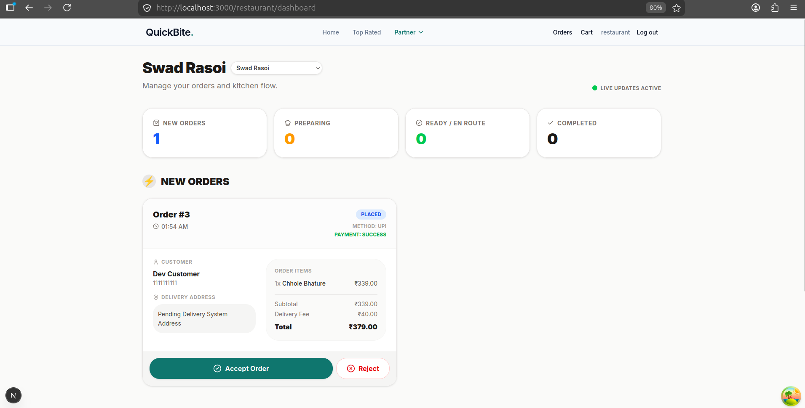

*Figure 4: **Live Kitchen Dashboard** (`docs/screenshots/resttracking.png`) — Partner console (`Swad Rasoi`) with active Server-Sent Events connection (`● LIVE UPDATES ACTIVE`), operational status counters (New Orders, Preparing, Ready, Completed), and live order action controls (`[Accept Order]`, `[Reject]`).*

---

### 5. Delivery Partner Logistics Console
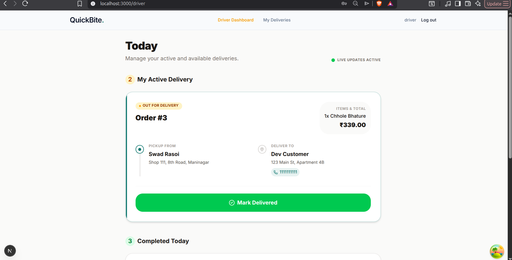

*Figure 5: **Driver Dispatch & Active Delivery Console** (`docs/screenshots/driver.png`) — Dedicated delivery partner interface showing real-time SSE listener (`● LIVE UPDATES ACTIVE`), active pickup and drop-off addresses, order items, and one-tap delivery completion action (`[Mark Delivered]`).*

---

### 6. Real-Time Customer Order Tracking
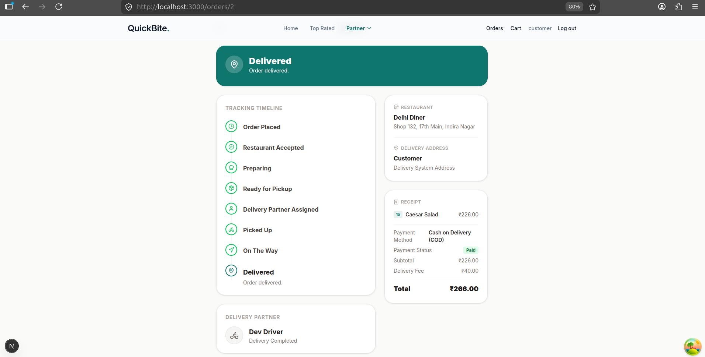

*Figure 6: **Customer Real-Time Order Progression** (`docs/screenshots/customer.png`) — Live SSE-synchronized tracking timeline (`Order Placed` → `Restaurant Accepted` → `Preparing` → `Ready for Pickup` → `Delivery Partner Assigned` → `Picked Up` → `On The Way` → `Delivered`), itemized digital receipt, Cash on Delivery settlement status (`Paid`), and assigned delivery partner credentials.*

---

## 📊 Verified Feature Matrix

Every feature listed below has been verified through backend test execution and automated end-to-end integration:

| Category | Capability | Status | Implementation Details |
| :--- | :--- | :---: | :--- |
| **Customer Experience** | Multi-City Restaurant Browsing | **Implemented** | 10,000+ seeded Indian restaurants across 28 major cities with pagination. |
| | Geolocation / Distance Search | **Implemented** | Native SQL Haversine formula on indexed coordinates (`/api/restaurants/nearby`). |
| | Interactive Menu & Cart | **Implemented** | Dynamic subtotal computation, item quantity controls, restaurant validation. |
| | Live Status Telemetry | **Implemented** | SSE streaming (`/api/events/stream`) tracking order states with visual step highlights. |
| | Order History & Receipts | **Implemented** | Itemized receipts, delivery fee calculations, payment method/status display. |
| **Payments & Settlements** | Razorpay Payment Gateway | **Implemented** | Order initiation, client SDK integration, server-side HMAC-SHA256 signature verification. |
| | Cash on Delivery (COD) | **Implemented** | First-class checkout selection, server validation, initial `PENDING` payment state. |
| | Driver Cash Handover Settlement | **Implemented** | Dedicated `/api/deliveries/{id}/collect-cash` endpoint with duplicate confirmation prevention (`409`). |
| | Payment Idempotency | **Implemented** | Versioned optimistic locking on `Payment` entity preventing double capture. |
| **Kitchen & Restaurant** | Partner Kitchen Dashboard | **Implemented** | Real-time KDS interface showing customer details, items, payment labels. |
| | Multi-Branch Switching | **Implemented** | Automated owner-matching allowing multi-restaurant oversight from single account. |
| | Menu Management (CRUD) | **Implemented** | Endpoints for item creation, pricing updates, availability toggling, deletion. |
| | Self-Service Onboarding | **Implemented** | Public registration form (`/restaurant/register`) producing `PENDING_APPROVAL` status. |
| **Logistics & Driver** | Available Delivery Pool | **Implemented** | Real-time available orders filtered for `READY_FOR_PICKUP` with COD value badges. |
| | Single-Claim Assignment | **Implemented** | Optimistic locking prevents race conditions between simultaneous drivers. |
| | Route Progress Lifecycle | **Implemented** | Transitions: `ASSIGNED` → `PICKED_UP` → `OUT_FOR_DELIVERY` → `DELIVERED`. |
| | Daily Delivery History | **Implemented** | Completed deliveries view with delivery timestamps and addresses. |
| **Security & Operations** | Stateless JWT Authentication | **Implemented** | HMAC-SHA256 signed JWTs with zero-trust IDOR mitigation. |
| | Role-Based Access Control | **Implemented** | Method security (`@PreAuthorize`) enforcing `CUSTOMER`, `RESTAURANT`, `DRIVER`, `OPERATOR`. |
| | Bucket4j Rate Limiting | **Implemented** | 50 req/min token bucket on authentication and payment endpoints. |
| | MDC Correlation Tracing | **Implemented** | `X-Correlation-Id` propagated through logs via SLF4J MDC filter. |
| | Platform Operator Console | **Implemented** | System statistics, pending application review, one-click approve/reject. |
| **Upcoming Enhancements** | Interactive Mapbox/Leaflet UI | *Planned* | Dynamic GPS vehicle tracking on live map canvas. |
| | Customer Handover OTP | *Planned* | 4-digit verification code required to complete delivery. |
| | Kubernetes & Helm Charts | *Planned* | Cloud-native deployment manifests and autoscaling rules. |

---

## 🛠️ Technology Stack

QuickBite uses a modern, type-safe stack:

### Backend Architecture
| Technology | Verified Version | Purpose & Implementation |
| :--- | :---: | :--- |
| **Java** | `21` | Modern LTS Java runtime utilizing virtual-thread-ready features and record types. |
| **Spring Boot** | `3.5.0` | Core modular monolith framework with Spring Data JPA and Spring Web. |
| **Spring Security** | `6.x` | Stateless authentication filter chain, BCrypt hashing, method-level authorization. |
| **JJWT (io.jsonwebtoken)** | `0.12.6` | Stateless token creation, claim parsing, and cryptographic verification. |
| **PostgreSQL** | `15+` | Primary relational database engine in production with ACID guarantees. |
| **Flyway** | `Core` | Version-controlled database schema migrations (`V1` to `V8`). |
| **H2 Database** | `2.3.232` | In-memory and file-based zero-configuration database for dev/testing. |
| **Bucket4j** | `8.1.1` | High-performance token-bucket algorithm for API rate limiting. |
| **Razorpay Java SDK** | `1.4.8` | Payment gateway API client for order generation and cryptographic verification. |
| **Spring Boot Actuator** | `3.5.0` | Operational telemetry with custom health indicators (`Payment`, `SSE`, `Outbox`). |

### Frontend Architecture
| Technology | Verified Version | Purpose & Implementation |
| :--- | :---: | :--- |
| **Next.js** | `16.3.4` | App Router framework with Turbopack bundler for SSR and client navigation. |
| **React** | `19.2.8` | Component model utilizing React Server Components and modern hooks. |
| **TypeScript** | `5.x` | Strict type definitions across DTOs, API responses, and client state. |
| **Tailwind CSS** | `4.x` | Utility-first CSS styling engine with custom design tokens. |
| **TanStack React Query**| `5.103.1` | Asynchronous server state synchronization, query caching, and invalidation. |
| **Fetch Event Source** | `2.0.1` | Resilient W3C Server-Sent Events client with custom headers and backoff retry. |
| **Lucide React** | `1.47.0` | Production icon package for platform interfaces. |

---

## 🏗️ System Architecture

### Component Architecture Diagram

```mermaid
flowchart TD
    subgraph Browser ["Web Browser Client Layer"]
        ClientApp["Next.js 16 Web Application (Port 3000)"]
    end

    subgraph SecurityPerimeter ["Security Perimeter (Port 8080)"]
        RateLimit["RateLimitFilter (Bucket4j - 50 req/min)"]
        Correlation["CorrelationIdFilter (MDC X-Correlation-Id)"]
        JwtFilter["JwtAuthenticationFilter (Stateless Bearer Validation)"]
    end

    subgraph CoreServices ["Spring Boot 3 Modular Domain Services"]
        AuthSvc["Auth & Customer Service"]
        RestSvc["Restaurant & Catalogue Service (Haversine Search)"]
        CartSvc["Cart Service"]
        OrderSvc["Order Lifecycle State Machine Engine"]
        DeliverySvc["Delivery & Dispatch Service (Optimistic Locking)"]
        PaymentSvc["Payment Service (Razorpay + COD Settlement)"]
        SseBroker["Server-Sent Events Broker (SseService)"]
    end

    subgraph StorageEngine ["Persistence & External Infrastructure"]
        PostgresProd[(PostgreSQL 15 / H2 Embedded)]
        RazorpayApi["Razorpay Payment Gateway API"]
    end

    ClientApp -->|HTTP REST Requests| RateLimit
    RateLimit --> Correlation --> JwtFilter

    JwtFilter --> AuthSvc
    JwtFilter --> RestSvc
    JwtFilter --> CartSvc
    JwtFilter --> OrderSvc
    JwtFilter --> DeliverySvc
    JwtFilter --> PaymentSvc

    ClientApp <-->|GET /api/events/stream (SSE)| SseBroker

    OrderSvc -.->|SystemEvent: Status Changed| SseBroker
    DeliverySvc -.->|SystemEvent: Delivery Telemetry| SseBroker
    PaymentSvc -.->|SystemEvent: Payment Settled| SseBroker

    PaymentSvc <-->|HMAC-SHA256 Verification| RazorpayApi

    AuthSvc <-->|JPA / HikariCP| PostgresProd
    RestSvc <-->|JPA / HikariCP| PostgresProd
    CartSvc <-->|JPA / HikariCP| PostgresProd
    OrderSvc <-->|JPA / HikariCP| PostgresProd
    DeliverySvc <-->|JPA / HikariCP| PostgresProd
    PaymentSvc <-->|JPA / HikariCP| PostgresProd
```

---

## 🔄 Core Business Workflows

### 1. The Complete Order Lifecycle (Finite State Machine)

Every order strictly progresses through an explicit finite state machine with role-based access validation at each transition:

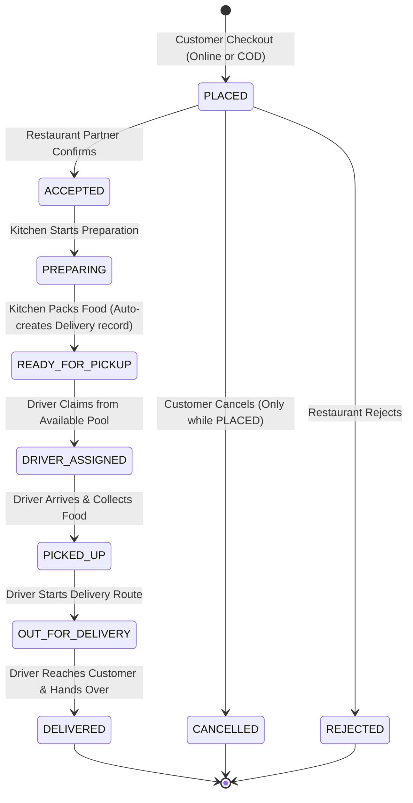

---

### 2. Dual-Mode Payment Settlement: Razorpay vs. Cash on Delivery (COD)

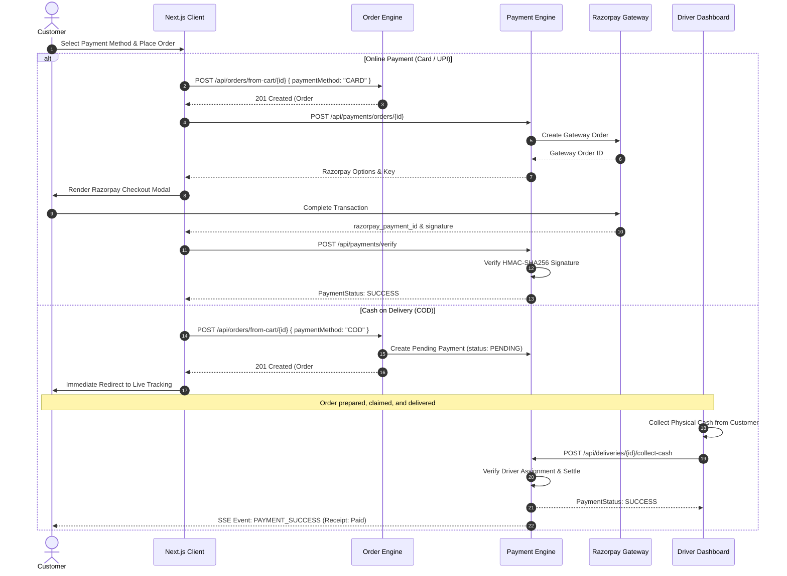

---

### 3. Driver Dispatch & Race-Condition Prevention

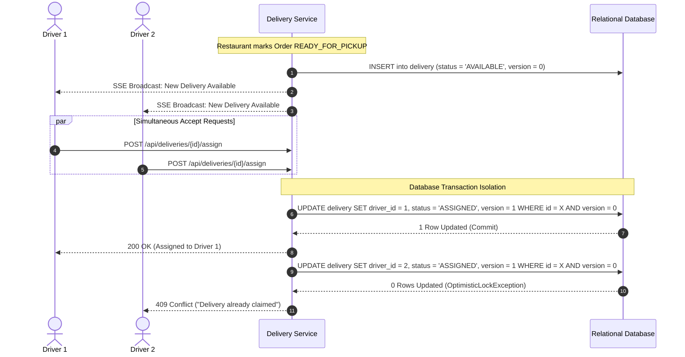

---

## 🗄️ Data Model & Database Architecture

QuickBite's relational schema is normalized with foreign keys and compound indexes. In production, Flyway automates migrations sequentially:

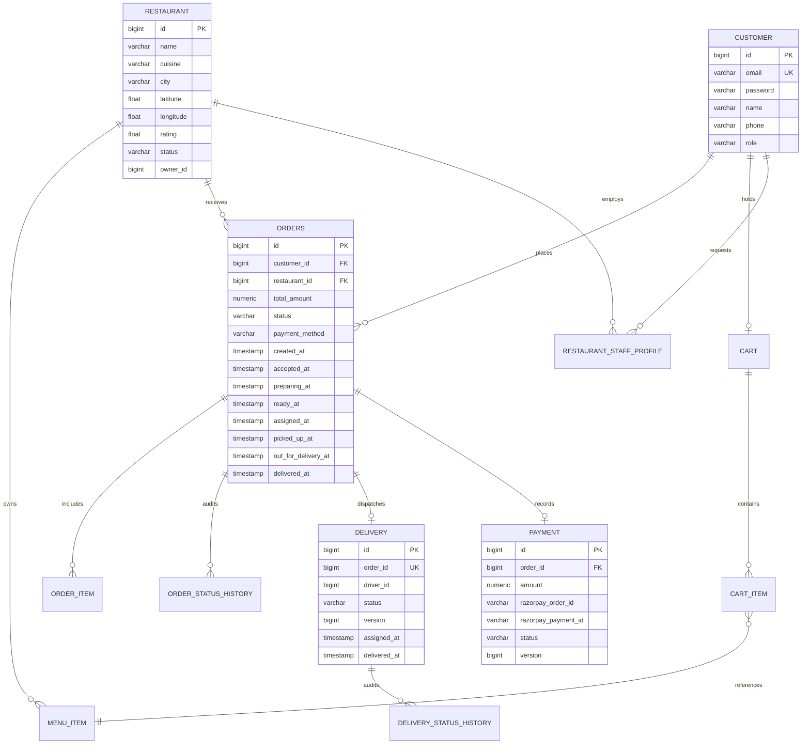

For complete table column definitions, foreign keys, and indexes, review the [Database Architecture Document](docs/database-design.md).

---

## 📁 Repository Structure

```
quickbite-app/
├── .env.example                       # Sanitized backend environment template
├── docker-compose.yml                 # Multi-container orchestration (Postgres + Backend + Frontend)
├── Dockerfile.backend                 # Multi-stage Eclipse Temurin 21 JDK/JRE image
├── pom.xml                            # Maven project definition (Spring Boot 3.5.0)
│
├── docs/                              # Detailed engineering documentation
│   ├── architecture.md                # In-depth architectural blueprint & SSE design
│   ├── api-reference.md               # Exhaustive REST API contract with schemas
│   ├── database-design.md             # ER diagrams, Flyway migrations, indexing specs
│   ├── local-development.md           # Developer onboarding, testing & diagnostics
│   └── roadmap.md                     # Planned product features & SRE/DevOps roadmap
│
├── frontend/                          # Next.js 16 single-page web application
│   ├── .env.example                   # Sanitized client environment template
│   ├── Dockerfile.frontend            # Multi-stage Node 18 Alpine builder
│   ├── package.json                   # Dependencies: TanStack Query, FetchEventSource, Tailwind v4
│   ├── src/
│   │   ├── app/                       # Next.js App Router route hierarchy
│   │   │   ├── page.tsx               # Discovery homepage with city & cuisine filters
│   │   │   ├── restaurants/           # Catalogue listing & restaurant menu pages
│   │   │   ├── cart/                  # Ephemeral cart view
│   │   │   ├── checkout/              # Dual-mode checkout page (Card/UPI/COD)
│   │   │   ├── orders/[id]/           # Real-time SSE live order tracking page
│   │   │   ├── restaurant/dashboard/  # Restaurant partner live kitchen display system
│   │   │   ├── driver/                # Driver operations dashboard (3-section view)
│   │   │   └── admin/dashboard/       # Operator restaurant review & approval console
│   │   ├── hooks/useSSE.ts            # Resilient SSE hook with automatic reconnection
│   │   └── lib/api.ts                 # Type-safe authenticated API client wrapper
│
└── src/                               # Spring Boot backend source tree
    ├── main/
    │   ├── java/com/quickbite/
    │   │   ├── admin/                 # Platform operator oversight & approval APIs
    │   │   ├── auth/                  # Registration, login, password reset tokens
    │   │   ├── cart/                  # Cart & cart items management
    │   │   ├── customer/              # Customer profile services
    │   │   ├── delivery/              # Dispatch management & driver assignment
    │   │   ├── event/                 # Multi-tenant Server-Sent Events broker
    │   │   ├── health/                # Actuator probes & custom health indicators
    │   │   ├── logging/               # MDC correlation ID filter & audit logger
    │   │   ├── menu/                  # Menu items CRUD & pricing
    │   │   ├── order/                 # Order lifecycle engine & strict state machine
    │   │   ├── payment/               # Razorpay verification & COD cash settlement
    │   │   ├── restaurant/            # Catalogue, Haversine search, onboarding
    │   │   └── security/              # JWT filters, Bucket4j rate limiting, RBAC
    │   └── resources/
    │       ├── application.properties # Baseline configuration (file-based H2)
    │       ├── application-dev.properties # Fast-track in-memory development profile
    │       ├── application-production.properties # Production profile with Flyway & Postgres
    │       └── db/migration/          # Sequential Flyway SQL migrations (V1 - V8)
    └── test/                          # Unit, security, and integration test suite (JUnit 5)
```

---

## 💻 Prerequisites

Ensure your host environment meets the following requirements:

- **Java JDK:** Version `21` or higher ([Eclipse Temurin](https://adoptium.net/) recommended)
- **Node.js:** Version `18.x` or `20.x` LTS
- **Build Tool:** Apache Maven `3.8+` (or use `./mvnw`)
- **Package Manager:** `npm` (included with Node.js)
- **Optional for Containers:** Docker Engine `24+` & Docker Compose `v2+`

---

## ⚡ Local Installation & Setup

### Option A: Fast-Track Zero-Database Setup (Recommended)
This approach boots an in-memory H2 database, automatically runs schema migrations, and seeds demo accounts and 10,000+ restaurants.

```bash
# 1. Clone repository
git clone https://github.com/RudraMandloi834/Quickbite-app.git
cd Quickbite-app

# 2. Setup environment files
cp .env.example .env
cp frontend/.env.example frontend/.env.local

# 3. Build & start backend (Terminal 1)
mvn clean compile
java -jar target/quickbite-app-0.0.1-SNAPSHOT.jar --spring.profiles.active=dev

# 4. Install dependencies & start frontend (Terminal 2)
cd frontend
npm install
npm run dev
```

Open your browser and navigate to **`http://localhost:3000`**.

### Option B: Full-Stack Docker Compose (PostgreSQL 15)
```bash
docker compose up --build
```
Spawns:
- PostgreSQL 15 on port `5432`
- Spring Boot on port `8080`
- Next.js on port `3000`

---

## 🔑 Demo Credentials (Password: `dev123`)

| Role | Email | Password | Access Area |
| :--- | :--- | :---: | :--- |
| **Customer** | `customer@test.com` | `dev123` | Browsing, ordering, live tracking |
| **Restaurant Partner** | `restaurant@test.com` | `dev123` | Kitchen dashboard (`/restaurant/dashboard`) |
| **Delivery Driver** | `driver@test.com` | `dev123` | Driver operations (`/driver`) |
| **Platform Operator** | `admin@test.com` | `dev123` | Admin dashboard (`/admin/dashboard`) |

---

## 🔐 Environment Variables Matrix

### Backend Variables (`.env`)
| Variable Name | Required | Default / Safe Example | Consuming Component | Description |
| :--- | :---: | :--- | :--- | :--- |
| `SPRING_PROFILES_ACTIVE` | No | `dev` | Spring Core | Determines active profile (`dev`, `production`, `test`). |
| `DB_URL` | Prod | `jdbc:postgresql://localhost:5432/quickbite` | DataSource | PostgreSQL JDBC connection URL. |
| `DB_USER` | Prod | `postgres` | DataSource | Database username. |
| `DB_PASSWORD` | Prod | `postgres` | DataSource | Database password. |
| `JWT_SECRET` | No | `sample-jwt-secret-key-at-least-256-bits` | `JwtService` | Secret key for signing HMAC-SHA256 tokens. |
| `RAZORPAY_KEY_ID` | No | `rzp_test_dummy` | `PaymentService`| Razorpay public Key ID for checkout modal. |
| `RAZORPAY_KEY_SECRET` | No | `dummysecret` | `PaymentService`| Razorpay secret for HMAC signature verification. |

### Frontend Variables (`frontend/.env.local`)
| Variable Name | Required | Default / Safe Example | Consuming Component | Description |
| :--- | :---: | :--- | :--- | :--- |
| `NEXT_PUBLIC_API_URL` | No | `http://localhost:8080` | `api.ts`, `useSSE.ts` | Backend REST & SSE base endpoint URL. |

---

## 📡 API Surface Overview

For complete JSON request and response contracts, view the [REST API Reference](docs/api-reference.md).

| Method | Endpoint | Access Level | Description |
| :--- | :--- | :---: | :--- |
| `POST` | `/api/auth/signup` | Public | Register new customer account. |
| `POST` | `/api/auth/login` | Public (Rate-limited) | Authenticate user credentials and return signed JWT. |
| `GET` | `/api/restaurants` | Public | Paginated list of approved restaurants with filters. |
| `GET` | `/api/restaurants/nearby` | Public | Geolocation spatial Haversine search (`lat`, `lng`, `radiusKm`). |
| `POST` | `/api/restaurants/apply` | Authenticated | Submit restaurant onboarding application. |
| `GET` | `/api/restaurants/{id}/menu` | Public | Retrieve restaurant menu categories and items. |
| `POST` | `/api/carts` | Customer | Create ephemeral customer cart. |
| `POST` | `/api/carts/{id}/items` | Customer | Add or update item quantity in cart. |
| `POST` | `/api/orders/from-cart/{id}` | Customer | Convert cart to order (`PLACED`), supporting COD selection. |
| `GET` | `/api/orders/{id}` | Order Stakeholders | Live status, timestamps, and payment status details. |
| `DELETE`| `/api/orders/{id}` | Customer | Cancel pending order (strictly when status is `PLACED`). |
| `PATCH` | `/api/restaurants/{rId}/orders/{oId}/status` | Restaurant Partner | Progress kitchen state (`ACCEPTED`, `PREPARING`, `READY`). |
| `GET` | `/api/deliveries/available` | Driver / Operator | Pool of unassigned orders awaiting pickup. |
| `POST` | `/api/deliveries/{id}/assign` | Driver / Operator | Claim available delivery (optimistic locking protected). |
| `PATCH` | `/api/deliveries/{id}/status` | Assigned Driver | Progress delivery route (`PICKED_UP`, `OUT_FOR_DELIVERY`, `DELIVERED`). |
| `POST` | `/api/deliveries/{id}/collect-cash` | Assigned Driver | Explicitly confirm COD cash collection, transitioning payment to `SUCCESS`. |
| `POST` | `/api/payments/orders/{id}` | Customer | Initiate Razorpay online checkout session. |
| `POST` | `/api/payments/verify` | Customer | Cryptographically verify Razorpay HMAC-SHA256 signature. |
| `GET` | `/api/events/stream` | Authenticated | Subscribe to live real-time Server-Sent Events stream. |
| `PUT` | `/api/admin/restaurants/{id}/approve` | Operator | Review and approve pending restaurant application. |

---

## 🛡️ Security, Auth & Rate Limiting

1. **Cryptographic Protection:** Passwords are hashed using BCrypt. JWTs are signed with HMAC-SHA256 and include issued-at and expiration timestamps.
2. **Zero-Trust Access Control:** Controller actions requiring user ownership strictly evaluate the authenticated subject via `SecurityUtils.getAuthenticatedCustomerId()` rather than parsing user IDs from request parameters.
3. **Token-Bucket Rate Limiter:** Applied on `/api/auth/*` and `/api/payments/*` via `Bucket4j` to prevent brute-force attacks and abuse.
4. **MDC Correlation Logging:** Every HTTP request is tagged with an `X-Correlation-Id` header (generated if absent) and tracked across all log entries via SLF4J MDC.

---

## 🧪 Testing & Quality Verification

QuickBite is backed by an automated test suite verifying unit logic, security rules, and end-to-end integration:

### 1. Backend Test Suite (JUnit 5 & MockMvc)
```bash
mvn test
```
*Result: 47 tests run, 0 failures, 0 errors (`BUILD SUCCESS`).*

### 2. Frontend Build & TypeScript Typecheck
```bash
cd frontend
npx tsc --noEmit
npm run build
```
*Result: Verified 0 TypeScript compilation errors and successful Turbopack page optimization.*

### 3. Automated Order Lifecycle & COD Verification
A standalone verification script executes all 22 lifecycle steps across live APIs:
```bash
python3 scratch/test_cod_verification.py
```
*Result: All 22 checks passed (COD placement, empty cart protection, Razorpay blocking, restaurant transitions, driver single-claim, unauthorized cash collection rejection, duplicate prevention, and final settlement).*

---

## 💳 Payments & Financial Settlement

QuickBite strictly separates **Order Logistics** from **Financial Settlement**:

- **Online Orders (Card / UPI):**
  - Customer completes payment via Razorpay modal.
  - Server verifies the cryptographic signature before dispatching the order to the kitchen.
  - Order is marked `PLACED` with `PaymentStatus = SUCCESS`.
- **Cash on Delivery Orders (COD):**
  - Order is placed without gateway interaction.
  - Order is marked `PLACED` with `PaymentStatus = PENDING`.
  - The order progresses through the kitchen and is claimed by a delivery partner.
  - Delivery UI highlights the exact cash amount to collect.
  - Driver collects physical currency and triggers **`Confirm Cash Collected`**.
  - Backend verifies driver authorization, transitions payment to `SUCCESS`, and broadcasts an SSE event.
  - Marking an order as `DELIVERED` **does not** mark it as paid.

---

## 🔧 Troubleshooting Guide

| Problem | Root Cause | Resolution |
| :--- | :--- | :--- |
| **Port 8080 already in use** | An existing background Spring Boot process is running. | Run `lsof -i :8080` and terminate the process with `kill -9 <PID>`. |
| **Port 3000 already in use** | An existing Next.js dev server is running. | Run `lsof -i :3000` and terminate the process with `kill -9 <PID>`. |
| **Database connection error** | PostgreSQL is not running when using `production` profile. | Use `--spring.profiles.active=dev` for H2 or start PostgreSQL via `docker compose up -d db`. |
| **CORS errors in browser** | Frontend origin is not allowed in `SecurityConfig`. | Ensure frontend is running on `http://localhost:3000` (pre-configured in `corsConfigurationSource`). |
| **401 Unauthorized on SSE stream** | Missing or expired JWT token. | Log out and log back in; the client automatically refreshes the token in `localStorage`. |
| **Payment verification fails (Dev)** | Razorpay signature mismatch in local testing. | When testing with `dev` profile and dummy keys, submit `dev_signature` to utilize the dev bypass. |

---

## 📈 Current Limitations & Roadmap

### Documented Technical Limitations:
- **Map Visualizations:** While restaurants have latitude and longitude coordinates and Haversine distance calculations are supported, driver GPS coordinates are currently not rendered on a live map canvas.
- **Single-Node SSE:** The current `SseService` emitter registry resides in JVM memory. Scaling across multiple backend nodes requires offloading event broadcasting to a distributed message bus (e.g., Redis Pub/Sub).
- **Automated Refunds:** Order cancellation currently marks the order `CANCELLED`, but automated refund processing through Razorpay's refund API is planned for a future milestone.

For the detailed infrastructure, CI/CD, Kubernetes, and SRE roadmap, review the [Engineering Roadmap Document](docs/roadmap.md).

---

## 🛡️ Security & Responsible Disclosure

- **Credential Hygiene:** Never commit `.env`, `.env.local`, or database files (`quickbite_db*`) to version control. The repository includes strict `.gitignore` patterns.
- **Payment Safety:** In non-production environments, use only mock or Razorpay sandbox credentials.
- **Vulnerability Reporting:** If you identify a security issue, please open an advisory or contact the maintainer directly instead of opening a public issue.

---

## 🤝 Contributing

Contributions to QuickBite are welcome! Please follow these standards:

1. Fork the repository and create a descriptive branch:
   ```bash
   git checkout -b feat/your-feature-name
   ```
2. Commit your changes following [Conventional Commits](https://www.conventionalcommits.org/):
   ```bash
   git commit -m "feat(order): add automated cancellation timeout"
   ```
3. Run verification checks before opening a pull request:
   ```bash
   mvn test
   cd frontend && npm run build && npx tsc --noEmit
   ```
4. Push your branch and submit a Pull Request to `main`.

For more guidelines, see [`CONTRIBUTING.md`](CONTRIBUTING.md).

---

## 📄 License & Repository Metadata

- **Repository:** [https://github.com/RudraMandloi834/Quickbite-app](https://github.com/RudraMandloi834/Quickbite-app)
- **Author & Maintainer:** [RudraMandloi834](https://github.com/RudraMandloi834) (`rudramandloi2005@gmail.com`)
- **License:** All source code and architectural documentation are maintained under standard portfolio copyright. (See project repository for open-source licensing updates).

---

<div align="center">
  <sub>Engineered with precision for production-grade food delivery workflows. Built with Spring Boot 3 & Next.js 16.</sub>
</div>
