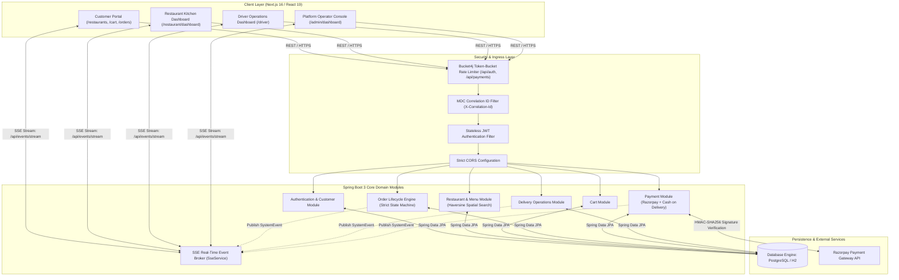

# QuickBite Architecture Documentation

QuickBite is architected as a modular, high-throughput food delivery platform comprising a Spring Boot 3 backend and a Next.js 16 single-page web client. This document provides an exhaustive technical breakdown of the system architecture, security perimeter, data flows, and concurrency models.

---

## 1. High-Level System Architecture

QuickBite adopts a decoupled client-server architecture. The browser client interacts with the Spring Boot backend via stateless HTTPS REST endpoints for transactional workflows and establishes persistent HTTP connections for Server-Sent Events (SSE) to receive asynchronous order and delivery telemetry.

---

## 2. Domain Decomposition & Package Topology

The backend application is structured around high-cohesion, domain-driven modules inside package `com.quickbite`:

| Package | Primary Responsibility | Key Entities & Services |
| :--- | :--- | :--- |
| `com.quickbite.auth` | User registration, authentication, JWT issuing, password reset | `AuthController`, `PasswordResetToken`, `CustomerRepository` |
| `com.quickbite.security` | JWT verification, RBAC, OAuth2 callbacks, Token-Bucket rate limiting | `JwtService`, `JwtAuthenticationFilter`, `RateLimitFilter`, `SecurityConfig` |
| `com.quickbite.customer` | Customer profile management, order query resolution | `CustomerController`, `CustomerService`, `Customer` |
| `com.quickbite.restaurant` | Restaurant listings, multi-city catalogue, geolocation search, onboarding | `RestaurantController`, `RestaurantService`, `Restaurant`, `RestaurantStaffProfile` |
| `com.quickbite.menu` | Menu categories, items, price configuration, availability toggling | `MenuItemController`, `MenuItemService`, `MenuItem` |
| `com.quickbite.cart` | Ephemeral customer cart, item addition, subtotal computation | `CartController`, `CartService`, `Cart`, `CartItem` |
| `com.quickbite.order` | Strict finite state machine for orders, audit timeline, ownership gating | `OrderController`, `OrderLifecycleService`, `Order`, `OrderStatusHistory` |
| `com.quickbite.payment` | Razorpay checkout initiation, webhook verification, COD cash settlement | `PaymentController`, `PaymentService`, `Payment`, `RazorpayClientWrapper` |
| `com.quickbite.delivery` | Dispatch pool, single-claim driver assignment, status transitions | `DeliveryController`, `DeliveryService`, `Delivery`, `DeliveryStatusHistory` |
| `com.quickbite.event` | Multi-tenant Server-Sent Events broker, role-scoped dispatching | `SseController`, `SseService`, `SystemEvent` |
| `com.quickbite.admin` | Platform operator oversight, restaurant application reviews | `AdminController`, `RestaurantAdminDTO` |
| `com.quickbite.health` | Actuator probes and custom health indicators | `HealthController`, `PaymentHealthIndicator`, `SseHealthIndicator` |
| `com.quickbite.logging` | MDC correlation IDs and structured auditing | `CorrelationIdFilter`, `AuditLogger` |

---

## 3. Security Architecture & Threat Mitigation

### 3.1 Stateless JWT Authentication
1. **Authentication:** Clients authenticate against `POST /api/auth/login` supplying email and password credentials.
2. **Token Generation:** The backend verifies credentials using Spring Security's `AuthenticationManager` backed by BCrypt password encoding (`strength = 12`). Upon verification, `JwtService` issues an HMAC-SHA256 signed JSON Web Token containing claims:
   - `sub`: User email address.
   - `customerId`: Database primary key of the customer.
   - `role`: Granted authority (`ROLE_CUSTOMER`, `ROLE_RESTAURANT_PARTNER`, `ROLE_DRIVER`, `ROLE_OPERATOR`).
3. **Stateless Authorization:** The `JwtAuthenticationFilter` intercepts inbound requests, extracts the `Authorization: Bearer <token>` header, validates cryptographic integrity and expiry, and populates the `SecurityContextHolder`.

### 3.2 Insecure Direct Object Reference (IDOR) Protection
To prevent IDOR vulnerabilities:
- Controllers and services do not rely on user-supplied customer IDs in request payloads.
- The authenticated identity is strictly derived from `SecurityUtils.getAuthenticatedCustomerId()`, extracting the principal directly from the validated JWT claims.
- Any attempt by a customer to inspect another customer's order, cart, or profile results in an immediate HTTP `403 FORBIDDEN`.

### 3.3 Rate Limiting via Token-Bucket Algorithm
- Implemented in [`RateLimitFilter`](file:///home/kuber/projects/quickbite-app/src/main/java/com/quickbite/security/RateLimitFilter.java) using the `Bucket4j` library.
- Gated endpoints: `/api/auth/*` and `/api/payments/*`.
- Capacity: 50 requests per minute per IP address with greedy refill.
- Exceeding clients receive HTTP `429 TOO MANY REQUESTS` with plain-text diagnostic headers.

---

## 4. Real-Time Telemetry: Server-Sent Events (SSE)

QuickBite utilizes standard W3C Server-Sent Events (`text/event-stream`) for unidirectional real-time updates from server to client. This avoids the protocol overhead and complex connection state of WebSockets while working seamlessly through firewalls, HTTP/2 multiplexing, and reverse proxies.

### 4.1 Connection Lifecycle
1. The client subscribes via `GET /api/events/stream`, passing their JWT in the `Authorization: Bearer <token>` header (via `@microsoft/fetch-event-source`).
2. `SseController` registers an `SseEmitter` with an indefinite timeout (`Long.MAX_VALUE`).
3. `SseService` registers the emitter in a concurrent multi-map keyed by `userId` and categorized by user role.
4. An immediate `INIT` handshake is dispatched to confirm stream activation.
5. Scheduled background heartbeats (`PING` comments) fire every 15 seconds to prevent intermediate proxy connection termination.

### 4.2 Selective Event Broadcasting
Events are emitted as structured `SystemEvent` records:
- **Customer Updates:** Dispatched strictly to `order.customerId` when order status transitions.
- **Restaurant Updates:** Dispatched to authenticated staff associated with `order.restaurantId`.
- **Driver Updates:** Dispatched to all available drivers on `READY_FOR_PICKUP`, or directly to the claimed driver once assigned.
- **Operator Updates:** Dispatched to all users possessing `ROLE_OPERATOR`.

---

## 5. Transaction Management & Concurrency Control

### 5.1 Optimistic Locking
High-contention entities ([`Delivery`](file:///home/kuber/projects/quickbite-app/src/main/java/com/quickbite/delivery/Delivery.java) and [`Payment`](file:///home/kuber/projects/quickbite-app/src/main/java/com/quickbite/payment/Payment.java)) feature a `@jakarta.persistence.Version` column. When two delivery partners attempt to claim the same order concurrently:
1. The first driver's transaction commits successfully, incrementing the version column.
2. The second driver's transaction detects a version mismatch and triggers an `OptimisticLockException` / `409 Conflict`, ensuring an order is never double-claimed.

### 5.2 Decoupled Payment and Order States
- Payment status (`PENDING`, `SUCCESS`, `FAILED`) is completely decoupled from the order lifecycle (`PLACED` through `DELIVERED`).
- Marking an order as `DELIVERED` does not artificially mark an order as paid.
- Cash collection for COD orders requires explicit driver/operator confirmation via `POST /api/deliveries/{id}/collect-cash`, which validates assignment, updates payment to `SUCCESS`, and broadcasts the update. Duplicate submissions are rejected with `409 Conflict`.
