# QuickBite Database Design & Schema Architecture

This document describes the relational database architecture, entity-relationship model, schema migration strategy, and indexing optimizations for the QuickBite platform.

---

## 1. Database Technologies & Profile Strategy

QuickBite supports a multi-profile database strategy to optimize for developer productivity during local testing and strict ACID relational guarantees in production:

| Profile | Engine | Mode | Schema Strategy | Connection URL / Config |
| :--- | :--- | :--- | :--- | :--- |
| **Production** (`production`) | **PostgreSQL 15+** | Relational Client-Server | **Flyway Migrations** (`ddl-auto=validate`) | `jdbc:postgresql://${DB_HOST}:5432/${DB_NAME}` |
| **Development** (`dev`) | **H2 Database** | In-Memory (`mem:quickbite_dev`) | Hibernate Schema Update (`ddl-auto=update`) | `jdbc:h2:mem:quickbite_dev;DB_CLOSE_DELAY=-1` |
| **Local Default** (`default`) | **H2 Database** | Embedded File (`file:./quickbite_db`) | Hibernate Schema Update (`ddl-auto=update`) | `jdbc:h2:file:./quickbite_db` |
| **Automated Testing** (`test`) | **H2 Database** | In-Memory Isolated (`mem:testdb`) | Dynamic DDL (`ddl-auto=create-drop`) | `jdbc:h2:mem:testdb` |

---

## 2. Entity-Relationship Diagram (ERD)

```mermaid
erDiagram
    CUSTOMER ||--o{ ORDERS : places
    CUSTOMER ||--o| CART : owns
    CUSTOMER ||--o| PASSWORD_RESET_TOKEN : has
    CUSTOMER ||--o{ RESTAURANT_STAFF_PROFILE : requests

    RESTAURANT ||--o{ MENU_ITEM : offers
    RESTAURANT ||--o{ ORDERS : fulfills
    RESTAURANT ||--o{ RESTAURANT_STAFF_PROFILE : employs
    RESTAURANT ||--o{ RESTAURANT_INVITATION : issues
    RESTAURANT ||--o{ RESTAURANT_JOIN_REQUEST : receives

    CART ||--o{ CART_ITEM : contains
    MENU_ITEM ||--o{ CART_ITEM : referenced_by

    ORDERS ||--o{ ORDER_ITEM : includes
    MENU_ITEM ||--o{ ORDER_ITEM : referenced_by
    ORDERS ||--o{ ORDER_STATUS_HISTORY : tracks
    ORDERS ||--o| DELIVERY : spawns
    ORDERS ||--o| PAYMENT : settles

    DELIVERY ||--o{ DELIVERY_STATUS_HISTORY : audits

    CUSTOMER {
        bigint id PK
        varchar name
        varchar email UK
        varchar password
        varchar phone
        varchar role
    }

    RESTAURANT {
        bigint id PK
        varchar name
        varchar cuisine
        varchar city
        varchar area
        varchar address
        float latitude
        float longitude
        float rating
        integer review_count
        integer price_range
        float delivery_radius
        integer delivery_time_minutes
        boolean delivery_availability
        varchar status
        varchar opening_time
        varchar closing_time
        bigint owner_id FK
        timestamp created_at
        timestamp updated_at
    }

    MENU_ITEM {
        bigint id PK
        bigint restaurant_id FK
        varchar name
        varchar description
        numeric price
        boolean available
        varchar image_url
    }

    CART {
        bigint id PK
        bigint customer_id FK
        bigint restaurant_id FK
        numeric total_amount
    }

    CART_ITEM {
        bigint id PK
        bigint cart_id FK
        bigint menu_item_id FK
        integer quantity
        numeric unit_price
        numeric subtotal
    }

    ORDERS {
        bigint id PK
        bigint customer_id FK
        bigint restaurant_id FK
        numeric total_amount
        varchar status
        varchar payment_method
        timestamp created_at
        timestamp accepted_at
        timestamp preparing_at
        timestamp ready_at
        timestamp assigned_at
        timestamp picked_up_at
        timestamp out_for_delivery_at
        timestamp delivered_at
    }

    ORDER_ITEM {
        bigint id PK
        bigint order_id FK
        bigint menu_item_id FK
        varchar menu_item_name
        integer quantity
        numeric unit_price
        numeric subtotal
    }

    ORDER_STATUS_HISTORY {
        bigint id PK
        bigint order_id FK
        varchar previous_status
        varchar new_status
        bigint changed_by_user_id
        varchar reason
        timestamp timestamp
    }

    PAYMENT {
        bigint id PK
        bigint order_id FK
        numeric amount
        varchar razorpay_order_id
        varchar razorpay_payment_id
        varchar status
        bigint version
        timestamp created_at
    }

    DELIVERY {
        bigint id PK
        bigint order_id UK
        bigint driver_id
        varchar driver_name
        varchar driver_phone
        varchar status
        bigint version
        timestamp created_at
        timestamp updated_at
        timestamp assigned_at
        timestamp picked_up_at
        timestamp out_for_delivery_at
        timestamp delivered_at
    }

    DELIVERY_STATUS_HISTORY {
        bigint id PK
        bigint delivery_id FK
        varchar previous_status
        varchar new_status
        bigint user_id
        varchar user_role
        varchar reason
        timestamp changed_at
    }
```



---

## 3. Schema Versioning & Flyway Migrations

In production, Flyway executes sequential SQL migration scripts located in `src/main/resources/db/migration`:

| Version | Script Name | Core Changes Applied |
| :--- | :--- | :--- |
| **V1** | `V1__Initial_schema.sql` | Baseline schema: tables for `customer`, `restaurant`, `menu_item`, `cart`, `cart_item`, `orders`, `order_item`, `payment`, `delivery`, indexes, and constraints. |
| **V2** | `V2__Add_restaurant_fields.sql` | Added `review_count`, `price_range`, `delivery_availability`, and `updated_at` to table `restaurant`. |
| **V3** | `V3__Clean_demo_data.sql` | Purged legacy US cities (New York, San Francisco, Austin, Chicago, Seattle) to enforce authentic Indian restaurant data. |
| **V4** | `V4__Add_indexes.sql` | Added indexing for `rating`, `area`, `location` to accelerate catalogue search. |
| **V5** | `V5__Add_missing_fields_and_indexes.sql` | Added `delivery_time_minutes`, compound index on `(latitude, longitude)`, and cuisine indexing. |
| **V6** | `V6__Add_restaurant_registration_fields.sql` | Added `phone`, `email`, `opening_time`, and `closing_time` for self-service partner onboarding. |
| **V7** | `V7__Order_Lifecycle_Timestamps.sql` | Added per-state audit timestamp columns: `accepted_at`, `preparing_at`, `ready_at`, `assigned_at`, `picked_up_at`, `out_for_delivery_at`, and `delivered_at`. |
| **V8** | `V8__Fix_Order_Enums.sql` | Normalized enum constraint checks across `orders` and `order_status_history` tables. |

---

## 4. Indexing & Query Optimizations

### 4.1 Geolocation Search Optimization
To enable fast location queries across 10,000+ restaurants without external GIS plugins, QuickBite indexes latitude and longitude:
```sql
CREATE INDEX idx_restaurant_coordinates ON restaurant(latitude, longitude);
```
The Haversine query calculates distance directly in SQL:
```sql
SELECT r.*,
  (6371 * acos(cos(radians(:latitude)) * cos(radians(r.latitude)) *
   cos(radians(r.longitude) - radians(:longitude)) +
   sin(radians(:latitude)) * sin(radians(r.latitude)))) AS distance
FROM restaurant r
WHERE (r.status = 'APPROVED' OR r.status IS NULL)
HAVING distance <= :radiusKm
ORDER BY distance ASC;
```

### 4.2 Composite & Lifecycle Indexes
- `idx_order_customer_id` on `orders(customer_id)`: Accelerates customer order history lookups.
- `idx_order_restaurant_id` on `orders(restaurant_id)`: Powers restaurant kitchen dashboard queries.
- `idx_order_status` on `orders(status)`: Optimizes kitchen order grouping.
- `idx_delivery_driver_id` on `delivery(driver_id)`: Speeds up driver active delivery queries.
- `idx_delivery_status` on `delivery(status)`: Optimizes the unassigned available delivery pool query (`status = 'AVAILABLE'`).
