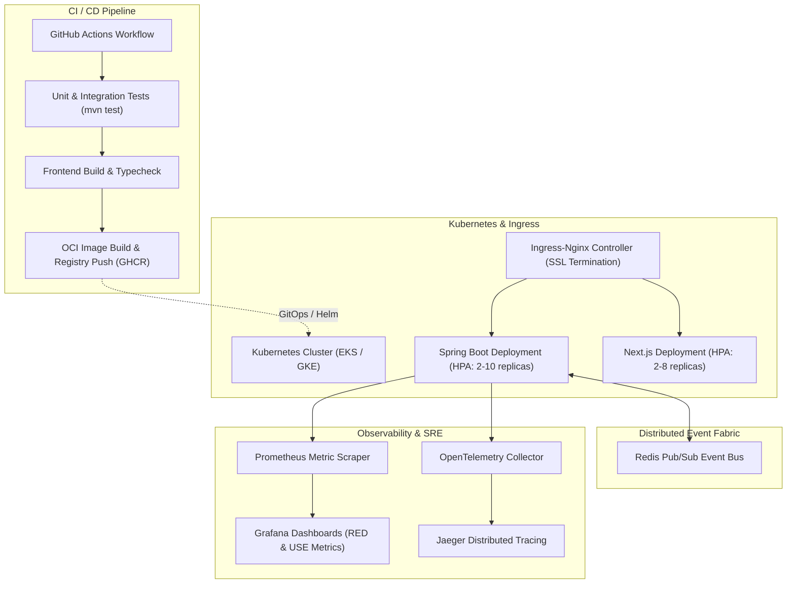

# QuickBite Engineering Roadmap

This document outlines the product features, engineering enhancements, and DevOps/SRE infrastructure planned for future milestones of the QuickBite platform.

---

## 1. Current System Status

QuickBite is an active full-stack food delivery application with a fully integrated order lifecycle engine, role-based dashboards, Cash on Delivery (COD) and Razorpay online payments, and Server-Sent Events (SSE) telemetry.

| Domain | Status | Key Highlights |
| :--- | :--- | :--- |
| **Customer Journey** | **Production-Ready Core** | Multi-city search, item carts, order tracking, dual-mode checkout (Online/COD). |
| **Kitchen Operations** | **Production-Ready Core** | Live dashboard, multi-restaurant management, real-time SSE updates. |
| **Driver Operations** | **Production-Ready Core** | Available pool, active delivery workflow, cash collection settlement. |
| **Operator Oversight** | **Production-Ready Core** | Restaurant onboarding reviews, application approval and rejection. |
| **Security & Resilience** | **Production-Ready Core** | Stateless JWT, Token-Bucket rate limiting (Bucket4j), MDC correlation logging. |
| **DevOps Infrastructure** | **Foundation** | Multi-stage Dockerfiles and Docker Compose configured; orchestration planned. |

---

## 2. Product Roadmap (Planned Enhancements)

```mermaid
flowchart LR
    subgraph Milestone1 ["Milestone 1: Experience & Maps"]
        M1A["Live GPS Maps (Leaflet / Mapbox)"]
        M1B["Customer Delivery ETA Estimation"]
        M1C["Push Notifications (Web Push / FCM)"]
    end

    subgraph Milestone2 ["Milestone 2: Multi-Factor & Auth"]
        M2A["Complete Google OAuth2 Flow"]
        M2B["SMS / Email OTP Verification for Handover"]
        M2C["Customer Address Book Management"]
    end

    subgraph Milestone3 ["Milestone 3: Financial Settlements"]
        M3A["Automated Refund Webhooks (Razorpay)"]
        M3B["Restaurant Weekly Payout Ledger"]
        M3C["Driver Earnings & Tips Calculator"]
    end

    Milestone1 --> Milestone2 --> Milestone3
```

### Detailed Product Milestones:
1. **Interactive Geospatial Tracking:**
   - Integrate Mapbox or Leaflet into `/orders/[id]` and `/driver` to display dynamic driver coordinates on an interactive map.
2. **Delivery Handover Verification (OTP):**
   - Implement dynamic 4-digit One-Time Password (OTP) generated upon `OUT_FOR_DELIVERY` that the customer shares with the driver before final delivery completion.
3. **Automated Refund Ledger:**
   - Webhook integration to trigger automatic Razorpay refunds if an order is cancelled while in `PLACED` state.
4. **Restaurant Owner Analytics:**
   - Revenue charts, peak ordering hours, and top-performing menu items for restaurant partners.

---

## 3. DevOps & SRE Roadmap

To scale QuickBite from a modular monolith into a highly available cloud-native platform, the following infrastructure milestones are planned:

### Key Infrastructure Targets:
1. **CI/CD Automation (GitHub Actions):**
   - Automated pull request verification: linting, Maven test execution, and Turbopack builds.
   - Automatic container image tagging and publishing to GitHub Container Registry (GHCR).
2. **Kubernetes Orchestration & Helm:**
   - Helm charts defining Deployments, ConfigMaps, Secrets, Horizontal Pod Autoscalers (HPA), and Ingress resources.
3. **Distributed Event Broker (Redis Pub/Sub):**
   - When scaling backend replicas beyond one node, connect `SseService` to a centralized Redis Pub/Sub cluster to broadcast order telemetry across all Spring Boot instances.
4. **Full-Stack Observability:**
   - Export OpenTelemetry spans across HTTP, database queries, and SSE streams to Jaeger.
   - Build Grafana dashboards tracking RED metrics (Rate, Errors, Duration) and Spring Actuator health metrics.
5. **Database High Availability & Disaster Recovery:**
   - Managed PostgreSQL with read replicas, connection pooling via PgBouncer, and continuous archiving via WAL-G.
